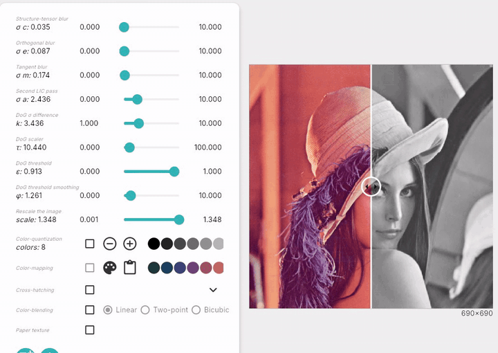

# portfolio-dog

An interactive, real-time implementation of the Flow-based eXtended Difference of Gaussians ([XDoG](https://doi.org/10.1016/j.cag.2012.03.004)), an image stylization technique that turns photos into pencil, charcoal, woodblock, watercolor and cross-hatching renderings.

**[Live demo](https://portfolio-8b527-dog.web.app)**

<picture>
  <source media="(prefers-color-scheme: dark)" srcset="docs/demo-dark.gif">
  
</picture>

## Highlights

- It's a multi-pass WebGL2 pipeline driven directly from Flutter through `package:web`.
- Edges are found by a difference of Gaussians across the local edge flow, then smoothed along it.
- Palettes can be generated in the Oklab color space, and there's a before/after comparison slider.

## Running locally

```sh
flutter pub get
dart run modular_localization
flutter run -d chrome
```

## License

Code: [BSD 3-Clause](LICENSE). The default sample image (Lena) isn't covered by this license.
